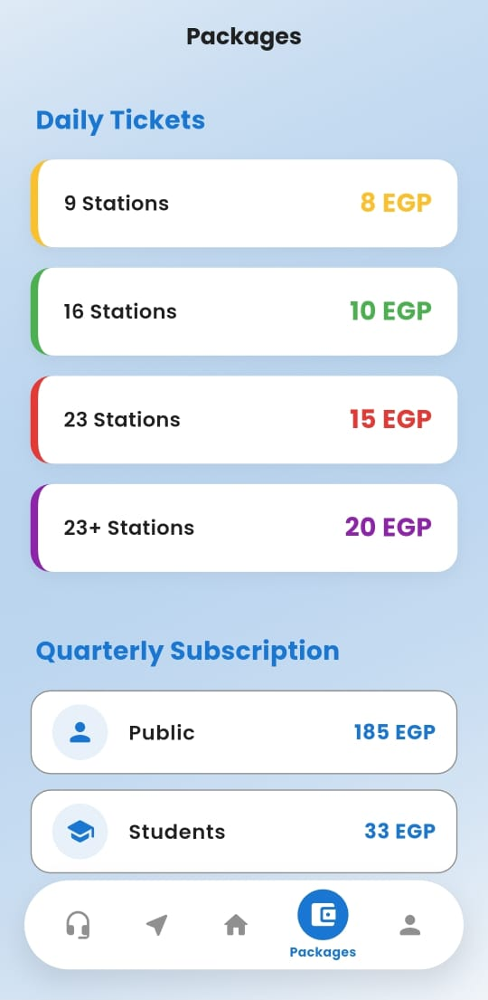
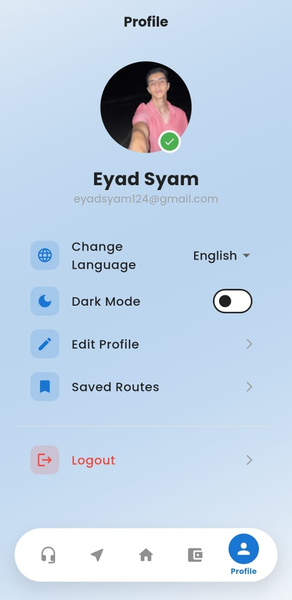
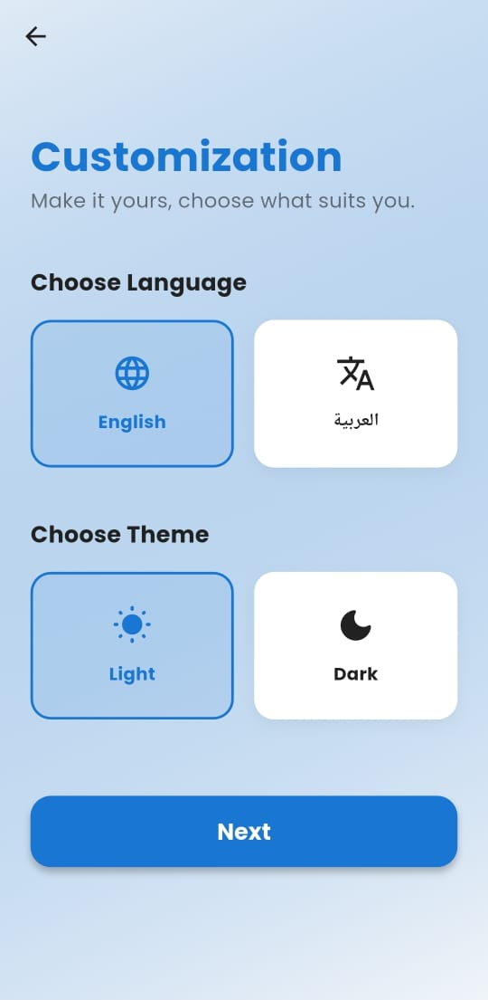
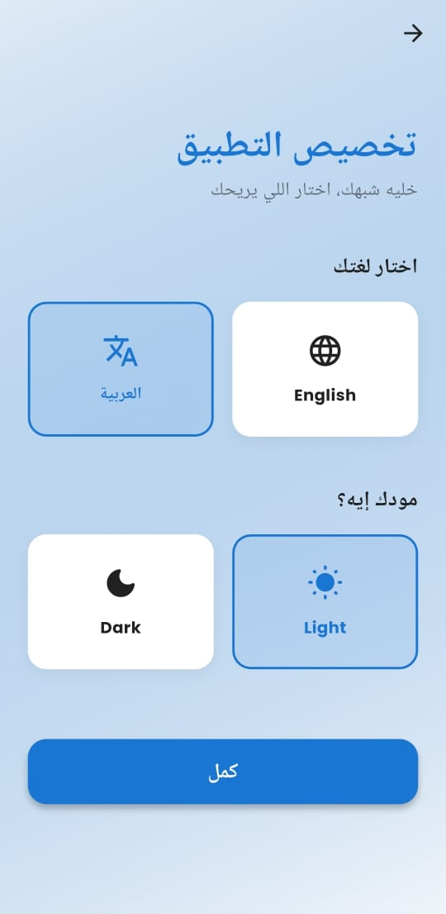

# Metro Masr - The Ultimate Cairo Metro Companion


**Metro Masr** is a smart, offline-first application designed to navigate the Cairo Metro system with ease. It combines powerful pathfinding algorithms with cloud synchronization to provide a seamless experience for commuters and tourists alike.

📖 **[Read the Full Project Documentation](FULL_PROJECT_DOCUMENTATION.md)** for deep technical details.

---

## 🚀 Key Features

*   **Smart Navigation**: Calculates the shortest path, estimated time, and number of stations using **Dijkstra’s Algorithm**.
*   **Offline-First**: Works perfectly without internet for core features using a local **SQLite** database.
*   **Cloud Sync**: Sign in with **Google** to sync your saved routes across devices using **Supabase**.
*   **Real-Time Pricing**: Accurate ticket costs based on the latest Cairo Metro fare rules.
*   **Subscriptions Manager**: View and calculate prices for Monthly, Quarterly, and Yearly plans.
*   **Nearest Station**: Uses GPS to instantly find the closest metro station to you.
*   **Bilingual**: Fully localized interface in **Arabic** and **English**.
*   **Dark/Light Mode**: Beautiful UI themes that adapt to your system settings.

---

## 🛠️ Technology Stack

*   **Frontend**: Flutter & Dart.
*   **State Management**: `flutter_bloc` (Cubit pattern) & `get_it` for DI.
*   **Backend & Auth**: **Supabase** (PostgreSQL, Auth, Cloud Functions).
*   **Local Database**: **Floor** (SQLite abstraction) for storing station data and graph edges.
*   **Navigation**: `go_router` for deep linking and smart routing.
*   **Maps**: `flutter_map` (OpenStreetMap).
*   **Localization**: `easy_localization`.

---

## 📱 App Screenshots

Experience the modern design and fluid animations of Metro Masr.

<div align="center">
  <table>
    <tr>
      <td align="center"><br /><b>Onboarding 1</b></td>
      <td align="center"><br /><b>Onboarding 2</b></td>
      <td align="center"><br /><b>Onboarding 3</b></td>
    </tr>
    <tr>
      <td align="center"><br /><b>Home Screen</b></td>
      <td align="center"><br /><b>Location Access</b></td>
      <td align="center"><br /><b>Search for Place</b></td>
    </tr>
    <tr>
      <td align="center"><br /><b>Route Details</b></td>
      <td align="center"><br /><b>Nearest Station</b></td>
      <td align="center"><br /><b>Saved Routes</b></td>
    </tr>
     <tr>
      <td align="center"><br /><b>Packages</b></td>
      <td align="center"><br /><b>Profile</b></td>
       <td align="center"><br /><b>Support</b></td>
    </tr>
     <tr>
      <td align="center"><br /><b>Customization (English)</b></td>
      <td align="center"><br /><b>Customization (Arabic)</b></td>
    </tr>
  </table>
</div>

---

## 🏁 Getting Started

1.  **Clone the repository**:
    ```bash
    git clone https://github.com/eyadsyam/metro_masr.git
    ```
2.  **Install dependencies**:
    ```bash
    flutter pub get
    ```
3.  **Generate Database Code**:
    ```bash
    dart run build_runner build
    ```
4.  **Run the app**:
    ```bash
    flutter run
    ```

---

## 🤝 Contributing

Contributions are welcome! Please fork the repository and submit a pull request for any enhancements or bug fixes.

---

<div align="center">
  Made with ❤️ for Egypt
</div>
