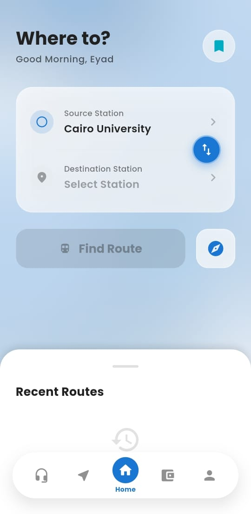
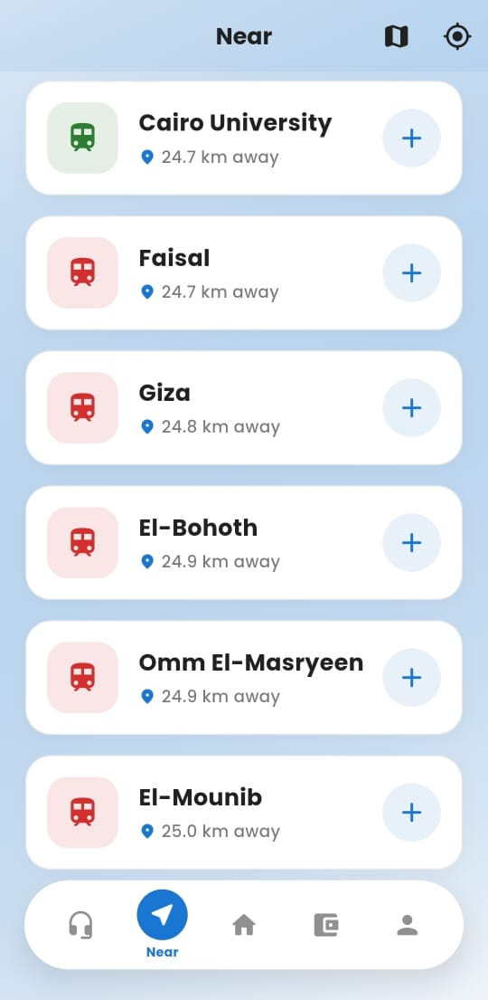
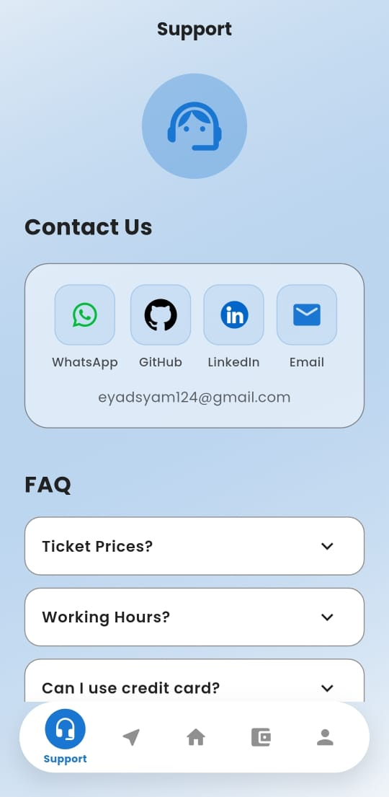
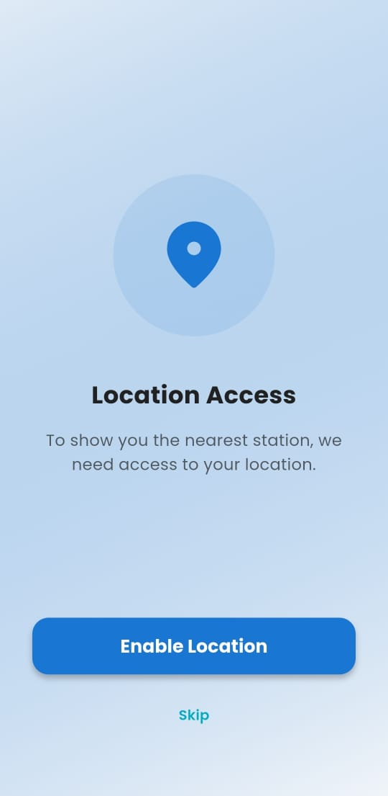
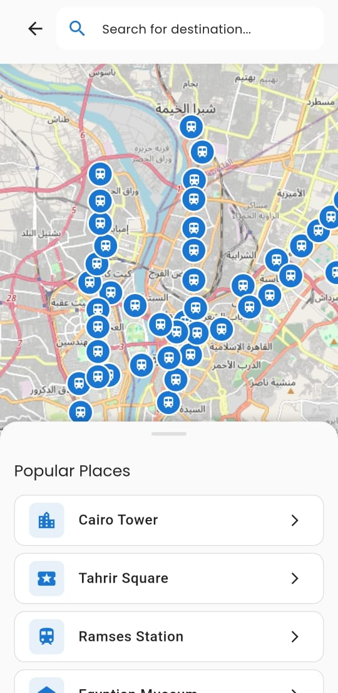
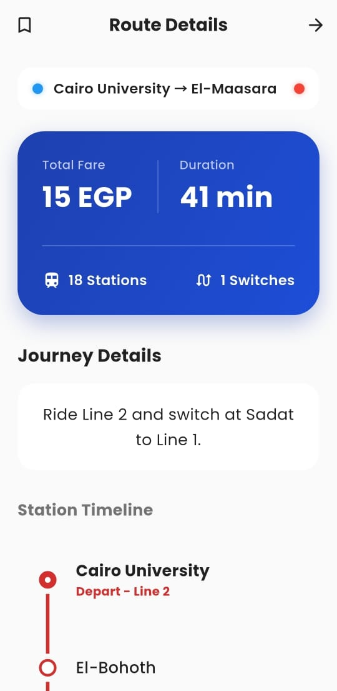

# 🚇 Metro Masr - The Ultimate Cairo Metro Companion


**Metro Masr** is a state-of-the-art Flutter application designed to provide the most smooth and intuitive navigation experience for the Cairo Metro system. Whether you are a daily commuter or a tourist exploring the city, Metro Masr ensures you reach your destination efficiently.

---

## ✨ Key Features

*   **⚡ Smart Route Planning**: Uses **Dijkstra's Algorithm** to find the absolute shortest path between any two stations.
*   **💰 Accurate Pricing**: Real-time ticket pricing calculation based on the number of stations.
*   **🌍 Bilingual Support**: Fully localized in **Arabic** and **English** for a seamless experience.
*   **🎨 Stunning UI/UX**: Built with Material 3, custom fonts (Outfit & Cairo), and vibrant animations using **Rive**.
*   **📍 Location Services**: Find the nearest metro station to your current location instantly.
*   **💾 Saved Routes**: Bookmark your frequent trips for quick access.
*   **📱 Responsive Design**: optimized for all screen sizes with a dark/light mode aesthetic.

---

## 📱 App Screenshots

Experience the modern design and fluid animations of Metro Masr.

<div align="center">
  <table>
    <tr>
      <td align="center"><br /><b>Onboarding / Splash</b></td>
      <td align="center"><br /><b>Home Screen</b></td>
      <td align="center"><br /><b>Route Planner</b></td>
    </tr>
    <tr>
      <td align="center"><br /><b>Station Details</b></td>
      <td align="center"><br /><b>Ticket Pricing</b></td>
      <td align="center"><br /><b>Navigation</b></td>
    </tr>
    <tr>
      <td align="center"><br /><b>Saved Routes</b></td>
      <td align="center"><br /><b>Settings</b></td>
      <td align="center"><br /><b>Search</b></td>
    </tr>
     <tr>
      <td align="center"><br /><b>App Drawer</b></td>
      <td align="center"><br /><b>Localization</b></td>
      <td align="center"><br /><b>Map View</b></td>
    </tr>
     <tr>
      <td align="center"><br /><b>Features</b></td>
      <td align="center"><br /><b>Overview</b></td>
    </tr>
  </table>
</div>

> *Note: Arrange and explore the screenshots to see the full flow of the application.*

---

## 🛠 Technology Stack

*   **Framework**: Flutter & Dart.
*   **State Management**: Bloc / Cubit.
*   **Navigation**: GoRouter.
*   **Localization**: easy_localization.
*   **Database**: Hive (for local storage).
*   **Algorithms**: Graph Theory (Dijkstra) for routing.
*   **UI Assets**: Rive Animations, Google Fonts.

---

## 🚀 Getting Started

1.  **Clone the repository**:
    ```bash
    git clone https://github.com/eyadsyam/metro_masr.git
    ```
2.  **Install dependencies**:
    ```bash
    flutter pub get
    ```
3.  **Run the app**:
    ```bash
    flutter run
    ```

---

## 🤝 Contributing

Contributions are welcome! Please fork the repository and submit a pull request for any enhancements or bug fixes.

---

<div align="center">
  Made with ❤️ for Egypt 🇪🇬
</div>
