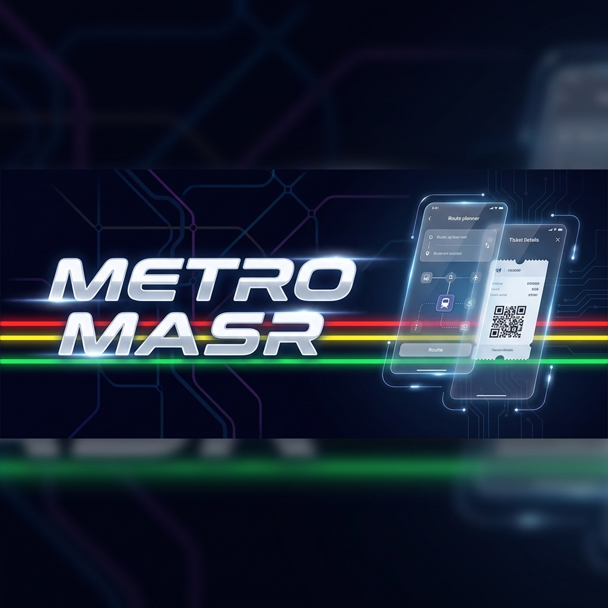
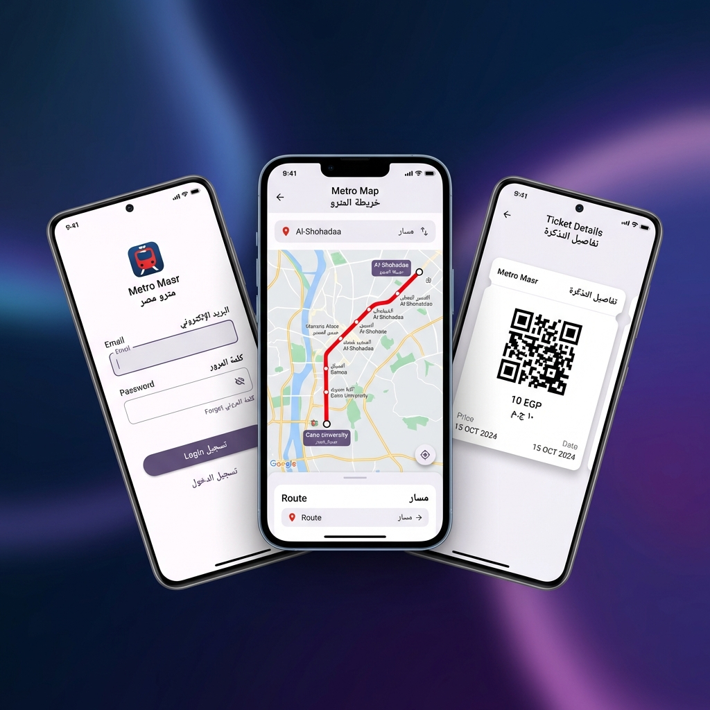

<div align="center">



# 🚇 Metro Masr (مترو مصر)

**The Ultimate Cairo Metro Navigation Companion**


</div>

---

## 🌟 Overview (نظرة عامة)

**Metro Masr** is a premium, cutting-edge Flutter application designed to make navigating the Cairo Metro system effortless. Built with a focus on User Experience (UX), performance, and Clean Architecture, this app provides real-time route planning, ticket pricing, and a beautiful, dynamic interface.

Whether you are a daily commuter or a tourist, Metro Masr ensures you never get lost underground.

---

## ✨ Key Features (المميزات الرئيسية)

*   **⚡ Smart Route Planning**: Uses **Dijkstra's Algorithm** to find the shortest path between any two stations instantly.
*   **💰 Ticket Pricing Calculator**: Automatically calculates ticket costs based on the number of stations (e.g., 8 EGP, 10 EGP, 15 EGP tiers).
*   **🗺️ Interactive Maps**: View station details, lines, and interchanges with a distinct visual style for each line.
*   **🌍 Multi-language Support**: Fully localized in **English** and **Arabic** (العربية), with RTL support.
*   **🎨 Dynamic Theming**: Beautiful Dark/Light modes and immersive animations using **Rive** and **Lottie**.
*   **📍 Nearby Stations**: Find the closest metro station to your current location (GPS integration).
*   **📱 Responsive Design**: Optimized for all screen sizes (Mobile & Tablet).

---

## 📱 App Showcase (معرض التطبيق)

<div align="center">
    
</div>

---

## 🛠️ Tech Stack & Architecture

This project is built using industry-standard tools and the **Clean Architecture** pattern to ensure scalability and maintainability.

*   **Framework**: [Flutter](https://flutter.dev/) (SDK > 3.0)
*   **Language**: [Dart](https://dart.dev/)
*   **State Management**: `flutter_bloc`
*   **Dependency Injection**: `get_it` & `injectable`
*   **Local Storage**: `hive` (NoSQL database)
*   **Localization**: `easy_localization`
*   **Navigation**: `go_router`
*   **Type Safety**: `freezed` & `json_serializable`
*   **Icons**: `lucide_icons` & Custom SVGs

### Folder Structure
```
lib/
├── core/           # Core utilities, config, and shared widgets
├── features/       # Feature-based modules (Metro, Auth, Payment)
│   ├── data/       # Repositories, Data Sources, Models
│   ├── domain/     # Entities, Use Cases, Repository Interfaces
│   └── presentation/ # BLoCs, Pages, Widgets
├── injection_container.dart # DI Setup
└── main.dart       # Entry point
```

---

## 🚀 Getting Started

### Prerequisites
*   Flutter SDK installed
*   Android Studio / VS Code
*   Git

### Installation

1.  **Clone the repository**:
    ```bash
    git clone https://github.com/eyadsyam/metro_masr.git
    ```
2.  **Navigate to the project directory**:
    ```bash
    cd metro_masr
    ```
3.  **Install dependencies**:
    ```bash
    flutter pub get
    ```
4.  **Run the app**:
    ```bash
    flutter run
    ```

---

## 🤝 Contributing

Contributions are welcome! If you have suggestions or want to improve the app, please create a Pull Request.

1.  Fork the Project
2.  Create your Feature Branch (`git checkout -b feature/AmazingFeature`)
3.  Commit your Changes (`git commit -m 'Add some AmazingFeature'`)
4.  Push to the Branch (`git push origin feature/AmazingFeature`)
5.  Open a Pull Request

---

<div align="center">

**Made with ❤️ in Egypt**

</div>
